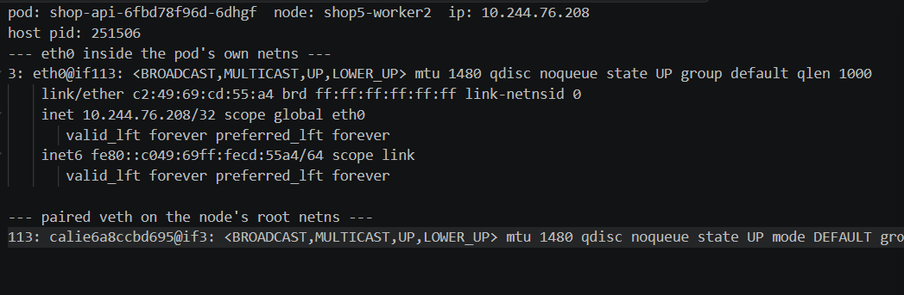
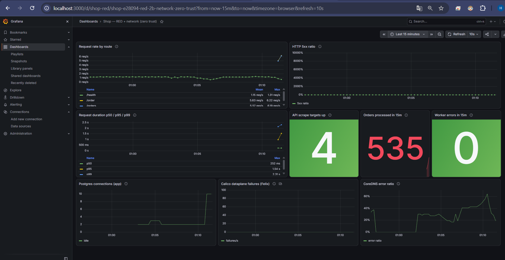
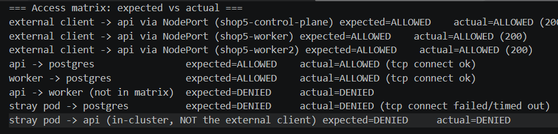
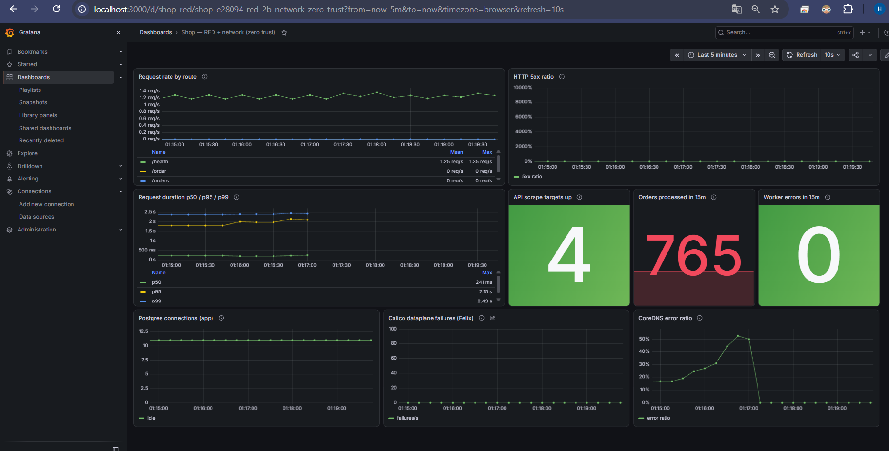
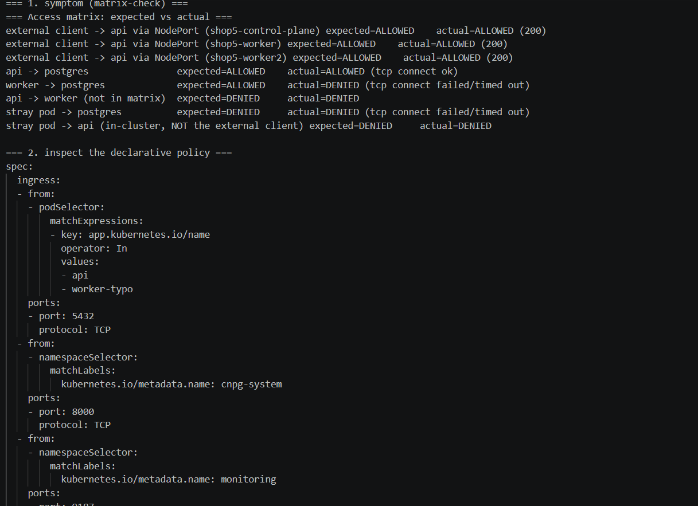
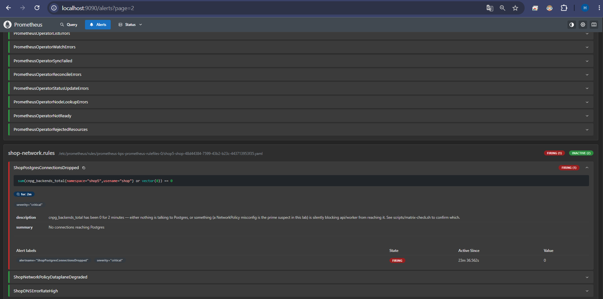
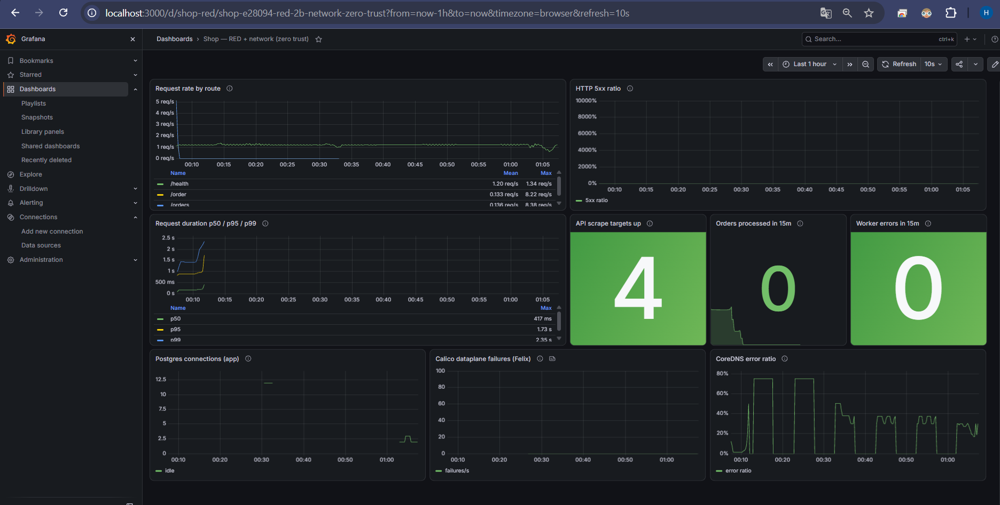

# Лаба 5 — Zero-trust сеть с доказательствами

Тот же `shop` (api/worker/postgres из lab3), но теперь про сеть: сначала доказываю,
что Service держит сервис живым, пока поды под капотом умирают и пересоздаются с
новыми IP, потом включаю zero-trust ("deny by default, open only what's needed") и
доказываю матрицей, а в конце нахожу спрятанный разрыв связности через средства
Calico, а не угадыванием.

## Стенд

| | |
|---|---|
| Хост | Windows 11, Docker Desktop (WSL2) |
| Кластер | kind `shop5`, Kubernetes 1.33.1, 3 ноды, `disableDefaultCNI: true` |
| CNI | Calico v3.29.1 (см. Part 0 — почему не Cilium) |
| Мониторинг | kube-prometheus-stack (Prometheus + Alertmanager + Grafana), чарт из lab2 |
| Postgres | CloudNativePG, 1 инстанс |

## Part 0 — выбор CNI

Начал с **Cilium** (хотелось Hubble как готовую traffic-карту для Part 6). Поставил
через Helm, `kubeProxyReplacement=false` (kube-proxy оставляю — он нужен для Part 2,
и там же нужно смотреть, в каком режиме он работает). Сразу всё поломалось:
Cilium безусловно пытается поставить iptables-правило с опцией `-m socket
--transparent` (TPROXY, нужно для встроенного DNS/L7-прокси) — а модуль ядра
`xt_socket`, который это обслуживает, в ядре Docker Desktop/WSL2
(`5.15.153-microsoft-standard-WSL2`) просто отсутствует (есть только nftables-версия
`nft_socket`). Перепробовал `envoy.enabled=false`, `l7Proxy=false`,
`bpf.tproxy=true` — ни один флаг этого конкретного правила не отключил: похоже, в
Cilium 1.20.4 это правило ставится безусловно, независимо от настроек, когда
включена установка iptables-правил вообще. Падающее правило валило всю транзакцию
reconciliation целиком, из-за чего вообще ломалась связность под→API-сервер
(`CrashLoopBackOff` у CNPG-оператора без внятной причины в логах — просто тихо
не мог достучаться).

Лаба явно разрешает **Calico** как равноценную альтернативу ("reliably enforces
policies"), и у неё нет такой TPROXY-зависимости вообще — переключился, не тратя
больше времени на охоту за версией Cilium, которая могла бы повести себя иначе.
Правильный диагноз (не "Cilium просто не работает", а конкретно "`xt_socket`
отсутствует в этом ядре") нашёл через `lsmod`/`modules.builtin` внутри узла —
`nft_socket.ko` есть, `xt_socket` нет.

## Part 1 — развёртывание и сеть пода под капотом

```bash
kind create cluster --config deploy/kind-cluster.yaml   # disableDefaultCNI: true
helm install calico ...   # манифест deploy/calico.yaml, CALICO_IPV4POOL_CIDR=10.244.0.0/16
# CNPG-оператор, kube-prometheus-stack, затем:
helm install shop charts/shop -n shop5
```

Смотрю под `shop-api` снаружи (образ distroless, внутри пода нет shell — лезу через
`nsenter` в его netns с ноды через `crictl inspect` → host PID):

```
eth0@if113: mtu 1480 ... inet 10.244.76.208/32 scope global eth0
default via 169.254.1.1 dev eth0
```

На ноде — парный veth с тем же номером интерфейса (113 у пода соответствует
peer-индексу 3 на хосте, и наоборот):

```
113: calie6a8ccbd695@if3: mtu 1480 ...
```

`/32` плюс "дефолтный маршрут через линк-локальный 169.254.1.1" — это калиcовская
модель point-to-point роутинга: нет настоящей L2-подсети, каждый под — отдельный
`/32`, маршрутизация через BGP/статические маршруты между нодами, не ARP.

Прямая связность под→под **между разными нодами** по IP (без NAT, без сервиса) —
`curl` из netns пода `worker` (нода `shop5-worker2`) прямо на IP пода `api` (нода
`shop5-worker`) на порт 8080 → `HTTP 200`. Флэт-сеть подтверждена.



## Part 2 — непрерывность под хаосом

`api` выставлен через `NodePort` (`values.yaml`: `api.service.type=NodePort`,
`nodePort=30080`) — это и есть "клиентская точка входа" из матрицы Part 3.
**`NodePort`** открывает порт на *каждой* ноде кластера и резолвится kube-proxy'м
в один из живых подов сервиса, независимо от того, на какой ноде сам под —
подтвердил `curl localhost:30080` с control-plane (там ни одного api-пода нет) и
получил `200`. **`LoadBalancer`** — это NodePort плюс внешний балансировщик, который
кто-то должен предоставить (cloud-провайдер или MetalLB); в kind без такого
провайдера `LoadBalancer`-сервис просто вечно висит в `<pending>`. **Headless**
сервис (`clusterIP: None`) не балансирует вообще — DNS-имя сервиса резолвится
прямо в список IP *всех* подов-бэкендов, и балансировку (или её отсутствие) решает
сам клиент; это паттерн для StatefulSet, где клиенту важно достучаться до
конкретного инстанса, а не "до сервиса вообще".

**kube-proxy режим:** `iptables` (не IPVS) — подтверждено `kube-proxy` ConfigMap'ом
и `iptables-save | grep -c KUBE-SVC` (63 цепочки). Разница между iptables и IPVS
реально имеет значение при большом количестве Service: iptables делает линейный
проход по цепочке правил на каждый пакет (O(n) от числа сервисов), IPVS — хэш-таблица
(O(1)). На 7 сервисах в этом кластере разницы не почувствовать; на проде с тысячами
Service iptables-режим даёт заметную деградацию latency при обновлении правил.

**Хаос + нагрузка:** `scripts/chaos.sh` убивает случайный `api`/`worker` под каждые
3-6 секунд; `scripts/load-job.yaml` гоняет `k6` *внутри* кластера на
`http://shop-api` (DNS-имя сервиса, не IP пода и не NodePort) — так трафик идёт
через полный путь Service → EndpointSlice → kube-proxy → DNS, который лаба и просит
проверить.

Первый прогон (до фикса): 21 под убит за 100с, **5 из 5686 запросов провалились**
(0.08%) — не флуктуация, конкретная причина: api обрабатывает `SIGTERM` через
`server.Shutdown()`, который закрывает HTTP-listener *немедленно*, включая
`/health` — но readiness-проба узнаёт об этом только на следующем цикле опроса
(`periodSeconds=5`), и в этом окне kube-proxy ещё считает под валидным
endpoint'ом. Добавил `lifecycle.preStop.exec: sleep 5` в api/worker
(`charts/shop/templates/{api,worker}-deployment.yaml`) — под продолжает отвечать
во время этого окна, и Service успевает убрать его из `EndpointSlice` раньше, чем
реально закроется listener. После фикса: **0 из 2544 запросов провалились** при 19
убитых подах за 90с (`evidence/part2-k6-zero-failures.txt`).



Честно: это не железобетонный ноль навечно — повторный прогон с тем же фиксом
при более агрессивном хаосе (18 убийств/90с) дал 7/1822 (0.38%), тем же классом
ошибок (`connection refused`/`reset by peer`). `kube-proxy`/`EndpointSlice`
eventually-consistent, не моментальны; preStop сильно сужает окно гонки, но не
доказуемо исключает её. Зафиксировал оба прогона
(`evidence/part2-k6-zero-failures.txt`), а не только удачный.

## Part 3 — проектирование матрицы доступа

| От | К | Разрешено? |
|---|---|---|
| внешний клиент | `api` (порт 8080, через NodePort) | ✅ |
| `api` | `postgres` (порт 5432) | ✅ |
| `worker` | `postgres` (порт 5432) | ✅ |
| любой под | `kube-dns` (порт 53, UDP+TCP) | ✅ (иначе никто никого не резолвит) |
| `api` | `worker` | ❌ (не нужно, в текущей архитектуре не общаются) |
| случайный/левый под | `postgres` | ❌ |
| всё остальное | всё остальное | ❌ (default-deny) |

## Part 4 — включение zero-trust

`charts/shop/templates/networkpolicy.yaml`, 5 объектов `NetworkPolicy`, значения
(лейблы/порты) — из `values.yaml#networkPolicy`:

1. **default-deny** — `podSelector: {}`, `policyTypes: [Ingress, Egress]`, без правил.
2. **allow-dns** — egress для всех подов на `kube-dns:53`.
3. **allow-client-to-api** — ingress на `api`, без `from` (пустой `from` = разрешить
   с любого источника, а не "ни с одного" — это единственное специально открытое
   правило).
4. **allow-egress-to-postgres** — egress с `api`/`worker` на `postgres:5432`.
5. **allow-ingress-to-postgres** — ingress на `postgres` от `api`/`worker`.

**Находка, которой не было в примере матрицы лабы:** после включения default-deny
CNPG-оператор начал писать в лог `Cannot extract Pod status: dial tcp
...:8000: i/o timeout` каждые пару секунд, а `Cluster.status.phase` застыл на
`Instance Status Extraction Error`. Оператор (из `cnpg-system`) опрашивает
instance manager каждого инстанса по HTTP на порту 8000 для статуса — этого
порта в исходной 3-бэллетной матрице просто нет, но без него control-plane
CNPG вслепую теряет из виду, жив ли кластер. Добавил отдельное ingress-правило на
`postgres`: `cnpg-system → :8000` и, за компанию, `monitoring → :9187` (иначе
Prometheus тоже не достанет метрики `cnpg_backends_total` для Part 7). И то, и
другое — ровно то, про что лаба просит не забыть ("the egress you actually need"),
просто не входит в иллюстративный пример.

## Part 5 — матрица в деле

`scripts/matrix-check.sh` реально заходит в сетевой namespace представителя каждой
роли (через `nsenter` на ноде, а не через `kubectl exec` — у api/worker/postgres
нет shell внутри, образы distroless/минимальные) и проверяет каждую ячейку:

```
external client -> api via NodePort (shop5-control-plane)  expected=ALLOWED   actual=ALLOWED (200)
external client -> api via NodePort (shop5-worker)          expected=ALLOWED   actual=ALLOWED (200)
external client -> api via NodePort (shop5-worker2)         expected=ALLOWED   actual=ALLOWED (200)
api -> postgres                                             expected=ALLOWED   actual=ALLOWED (tcp connect ok)
worker -> postgres                                          expected=ALLOWED   actual=ALLOWED (tcp connect ok)
api -> worker (не в матрице)                                expected=DENIED    actual=DENIED
stray pod -> postgres                                       expected=DENIED    actual=DENIED
stray pod -> api (не внешний клиент)                        expected=DENIED    actual=DENIED
```

Полностью зелёно. Отдельно показателен последний пункт: специально заведённый
"левый" под *внутри* namespace, без ролевых лейблов, не может достучаться даже до
api — хотя ingress-правило api открыто для *любого* источника. Причина: у этого
пода тоже default-deny egress, и для него нет собственного правила "можно выйти
на api" — zero-trust работает в обе стороны одновременно, не только "кто может
войти", но и "кому самому можно куда-то выйти". Это не входит в лабскую матрицу
буквально, но без этого наблюдения легко подумать, что открытый ingress на api
значит "любой под достанет api", а это не так.




## Part 6 — поиск спрятанного разрыва

`scripts/inject-fault.sh` вслепую выбирает одну из 4 заготовленных порч и
применяет через `helm upgrade --set networkPolicy.fault.inject=...`:
`wrong-worker-label`, `wrong-postgres-port`, `disable-dns`, `wrong-api-port`.

**Симптом** (`matrix-check.sh`): всё зелено, кроме одной строки —
`worker -> postgres: expected=ALLOWED actual=DENIED`. Остальное работает, то есть
это не полный отказ, а именно "заказы тихо перестают проходить" из формулировки
лабы — `api` всё ещё принимает запрос и отвечает 201, но `worker` не может
дотянуться до базы, чтобы его обработать.

**Диагностика (не угадывание):**

1. Смотрю сам объект `NetworkPolicy` декларативно:
   ```
   kubectl -n shop5 get networkpolicy shop-allow-ingress-to-postgres -o yaml
   ...
   - key: app.kubernetes.io/name
     operator: In
     values: [api, worker-typo]       # !! реальные поды worker помечены "worker"
   ```
2. Это уже похоже на причину, но YAML может не совпадать с тем, что реально
   применено в датаплейне — у OSS Calico нет Hubble-подобной traffic-карты с
   построчным логом denied-пакетов (это фича Calico Enterprise/flow-logs, не
   community-версии — проверил напрямую через Felix `/metrics` и
   `logSeverityScreen: Debug`, реального per-packet deny лога там нет). Вместо
   этого — её собственный реальный инструмент принятия решений: ipset'ы,
   которые Felix вычисляет из `podSelector`'ов и накатывает в iptables.
   ```
   kubectl -n kube-system exec calico-node-58dmc -c calico-node -- ipset list -n
   # cali40s:eb9Pcvp... <- вычисленное множество "кому разрешён ingress на postgres"
   ipset list cali40s:eb9Pcvp...
   # Members: 10.244.76.240, 10.244.254.34, 10.244.76.244, 10.244.254.36
   # -- это 4 IP api-подов, и ни одного IP worker-подов --
   ```
   Это и есть прямое доказательство на уровне датаплейна, не чтение YAML "на
   веру": вычисленное множество разрешённых источников реально не включает
   worker.

**Фикс:** `scripts/fix-fault.sh` (возвращает `networkPolicy.fault.inject=none`) —
матрица снова зелёная.



## Part 7 — мониторинг

Переиспользован стек из lab2 (kube-prometheus-stack), новые `ServiceMonitor`/
`PodMonitor`/`PrometheusRule` — часть чарта `shop`.

**connections** — `cnpg_backends_total` (CNPG включает через
`Cluster.spec.monitoring.enablePodMonitor: true`, PodMonitor создаётся
автоматически). Фильтрую по `usename="shop"`, чтобы не путать с постоянным
служебным соединением `cnpg_metrics_exporter`, которое есть всегда и маскирует
реальный простой.

**traffic denied by policy** — здесь пришлось подвинуть ожидания под реальность:
у OSS Calico (в отличие от Cilium/Hubble или Calico Enterprise) **нет**
Prometheus-метрики "сколько пакетов отброшено политикой" — проверил весь список
метрик на `/metrics` Felix'а (порт 9091, `prometheusMetricsEnabled: true` в
`FelixConfiguration`), ничего с "deny"/"drop" в счётчиках пакетов там нет.
Беру ближайший честный заменитель: `felix_int_dataplane_failures` — если Felix
сам не может применить iptables/ipset-обновления, значит zero-trust матрица
может оказаться *не* тем, что реально работает в датаплейне, даже если YAML
выглядит правильно (именно это и произошло во время переключения Cilium→Calico).

**DNS health** — `coredns_dns_responses_total` по `rcode` (kube-prometheus-stack
уже скрейпит CoreDNS из коробки) — доля не-`NOERROR` ответов.

### 3 алерта (`charts/shop/templates/prometheusrule.yaml`)

| Алерт | Метрика | Почему |
|---|---|---|
| `ShopPostgresConnectionsDropped` | `cnpg_backends_total{usename="shop"}` | Если у приложения 0 реальных соединений к базе — либо всё упало, либо (чаще на практике) сеть/политика тихо режет доступ, а приложение само по себе выглядит живым (api продолжает отвечать на `/health`). |
| `ShopNetworkPolicyDataplaneDegraded` | `felix_int_dataplane_failures` | Сигнал "сам механизм enforcement сломан" — zero-trust не защищает, если Calico физически не успевает применять правила. |
| `ShopDNSErrorRateHigh` | `coredns_dns_responses_total` | Весь сценарий Part 2 ("Service переживает хаос") держится на DNS; если DNS деградирует, эта гарантия перестаёт работать, даже если Service/EndpointSlice не менялись. |

**Сработавший алёрт:** `ShopPostgresConnectionsDropped`. Специально повторно
внёс `wrong-postgres-port` (ломает доступ *обоим* — `api` и `worker`, в отличие
от `wrong-worker-label`, который рвёт только `worker`), перезапустил
`api`/`worker` (у существующих TCP-соединений conntrack не обязан рвать их при
смене политики — проверил: после смены политики счётчик соединений не падал,
пока не перезапустил поды и они не попытались подключиться заново) — через 2
минуты алёрт `firing`.




## Итог

Самое ценное здесь — не то, что zero-trust в итоге заработал (матрица и так
довольно механическая задача), а три места, где реальность расходится с
учебниковой картинкой ровно там, где это стоило бы знать заранее. Во-первых,
смена CNI — это не "поменял values.yaml", а реальная зависимость от конкретного
ядра: один и тот же Cilium работает на типичном Linux-хосте и ломается на
WSL2 из-за отсутствующего `xt_socket`, и без разбора по `lsmod` я бы потратил
намного больше времени, перебирая версии Cilium вместо смены CNI. Во-вторых,
"default-deny по книжке" ломает не только то, что было в плане — CNPG-оператору
и Prometheus'у нужны свои отдельные дырки, про которые ни одна трёхпунктная
матрица из методички не напишет, и единственный способ это узнать — реально
включить policy и посмотреть, что перестало работать, а не разложить всё на
бумаге и остановиться. В-третьих, "докажи матрицей" и "докажи логами
Calico" на практике означают разные инструменты, чем на Cilium: вместо
красивого Hubble UI с построчным deny — вычисленный Felix'ом ipset, который
даёт то же самое доказательство (что реально разрешено на уровне датаплейна),
просто не в виде картинки.

P.s. Отдельно позабавило, что patch одного поля в `FelixConfiguration`
(добавление порта в спек DaemonSet calico-node, чтобы PodMonitor вообще смог
его найти) вызвал one-shot rolling restart всех трёх calico-node одновременно —
и этого хватило, чтобы на пару секунд просел CNPG-оператор и Cluster показал
`Instance Status Extraction Error`, хотя сама причина была совсем не про
NetworkPolicy. Пришлось отдельно убеждаться, что это дребезг от restart'а
Calico, а не регрессия в самой матрице доступа — разница между "что-то не так
с сетью прямо сейчас" и "что-то не так с конкретно той политикой, которую я
только что поменял" далась не сразу.

P.s.s. И снова windows, я не ищу легких путей